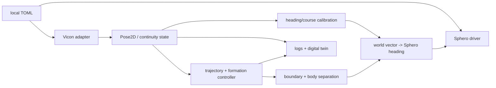
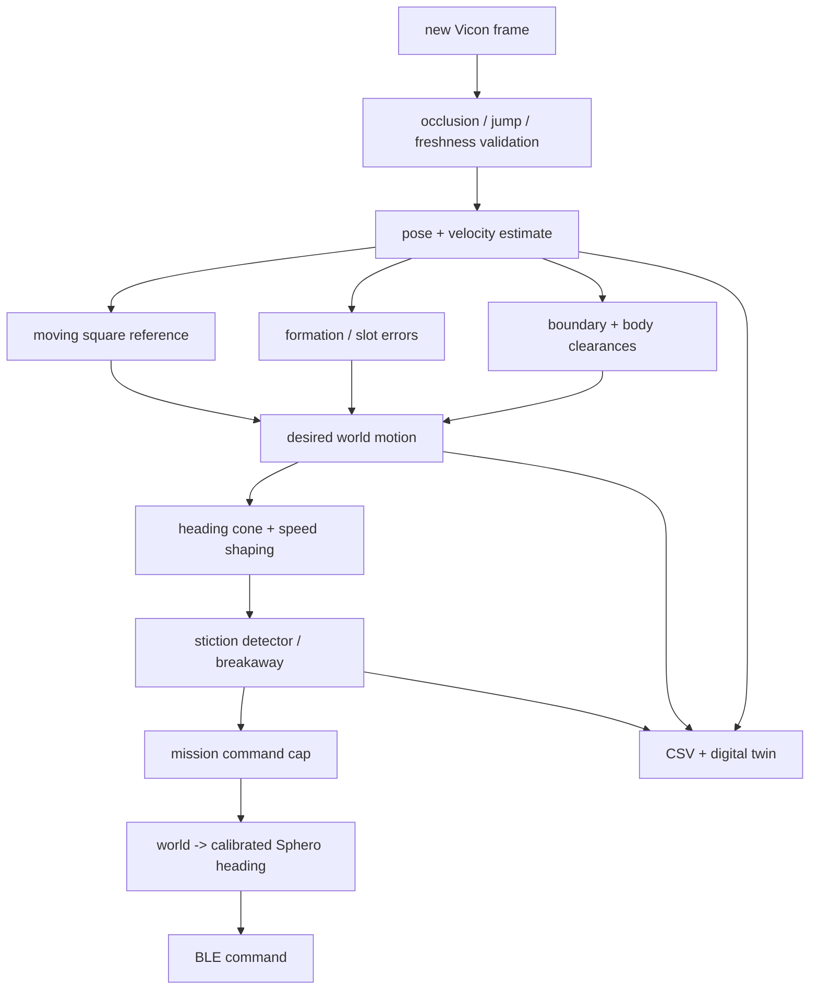

# Architecture

The repository is intentionally split into two layers:

1. a **small reusable package** with testable configuration, tracking, calibration, control and simulation primitives;
2. **reference controllers** that preserve complete experimental workflows, including hardware connection, calibration, safety, logging and the digital twin.

This lets a new user understand/test the basic mathematics without first understanding the feature-rich swarm script.

## System view



## Configuration boundary

The private local TOML owns:

- Vicon host and coordinate convention;
- measured workspace;
- Sphero/Vicon identity mapping;
- physical chassis dimensions;
- optional body-yaw geometry offset.

It does **not** store reusable controller source.

The examples and both reference controllers now consume the same TOML mapping.

## Reusable package

### config.py

Parses TOML/environment configuration into typed dataclasses and rejects invalid/placeholder hardware values unless explicitly allowed.

### models.py

Defines plain state/configuration data types such as RobotSpec and Pose2D.

### tracking/vicon.py

Owns DataStream SDK interaction:

- client creation;
- Connect;
- ServerPush request when available;
- small buffer;
- segment-data enable;
- frame acquisition;
- global translation/Euler rotation;
- floor-plane/yaw conversion.

The rest of the reusable package does not need to know Vicon SDK object structure.

### drivers/

Defines the narrow robot-command boundary. The public Sphero implementation wraps the third-party SpheroEduAPI and provides connect, command, stop and close operations.

### calibration.py

Implements the measured two-vector heading basis.

If measured world displacements for Sphero headings 0° and 90° are:

```text
e0  = [e0x,  e0y]
e90 = [e90x, e90y]
```

then a desired world vector is represented in that measured basis rather than by assuming an angle offset.

The determinant provides a quick degeneracy check: nearly collinear calibration vectors are rejected.

### control.py

Contains hardware-independent controller primitives operating on plain Python state.

### trajectory.py

Contains path/geometry helpers.

### simulation.py

Provides hardware-free state evolution for testing package/controller structure.

## Reference controller layer

### Single-chariot circle

Purpose:

- prove Vicon/Sphero integration on one physical agent;
- measure heading 0/90 displacement;
- convert desired world motion to Sphero heading;
- use slow, bounded motion;
- stop on persistent wrong-way evidence.

It now reads robot identity from the shared TOML and can select a robot with --robot.

### Three-chariot square swarm

The advanced script preserves the full experimental controller in one executable reference workflow.

It owns:

- fresh/reused startup calibration;
- Vicon continuity/reacquisition;
- per-robot course correction;
- velocity estimation;
- formation-slot logic;
- square moving reference;
- boundary/body separation;
- stiction detection and pulses;
- adaptive drive response;
- persistent learning/ILC;
- CSV logging;
- digital twin.

The script is intentionally a reference controller rather than the minimal reusable API.

## Advanced runtime data flow



## Identity model

There are three identities a new user must not confuse:

| Identity | Example role |
|---|---|
| software label | robot-1 |
| BLE/Sphero device | physical actuator |
| Vicon subject/segment | measured rigid body |

The TOML binds them explicitly.

The Vicon-only monitor proves the tracking side by hand. Sphero smoke tests prove the actuator side.

## Coordinate frames

### Vicon world frame

Defined by the Tracker volume origin.

### Vicon segment/body yaw

Useful for physical footprint orientation/diagnostics, but not assumed to be the Sphero steering frame.

### Sphero command frame

The actuator heading convention.

### Measured travelling frame

Learned from actual displacement. This is the steering bridge used by the controllers.

## Timing

There are different rates for different jobs:

- Vicon frame acquisition;
- control-state update;
- BLE command publication;
- digital-twin publication/GUI;
- status print/log flush.

They are intentionally not assumed to be a single hard-real-time loop.

## State continuity and occlusion

The advanced controller distinguishes:

- brief occlusion;
- visible but implausible pose jump;
- sustained state loss;
- consistent reacquisition.

A single bad frame should not create a large correction, while persistent loss should stop motion and require a credible state before continuing.

## Physical geometry

Collision/boundary reasoning uses the chassis footprint rather than treating each robot as an ideal point.

The advanced controller loads body dimensions from TOML and uses the largest of the first three configured footprints as a conservative common collision rectangle.

body_yaw_offset_deg affects footprint orientation only.

## Persistent runtime artifacts

The controller may generate:

- CSV logs;
- heading-calibration reference JSON;
- drive/formation learning JSON;
- square-path ILC JSON.

These are ignored by Git by default.

Treat them as **measured state tied to a physical setup**, not universal constants.

## Failure containment

The architecture tries to fail at the narrowest layer:

- config placeholder → reject before hardware;
- Vicon identity mismatch → pose-monitor gate;
- Sphero mismatch → smoke-test gate;
- invalid heading basis → calibration failure;
- tracking loss → stop/reacquire;
- boundary/separation issue → constrain/recover;
- exception/Ctrl+C → cleanup/stop paths.

For the operational sequence, see the [end-to-end tutorial](end-to-end-tutorial.md).
