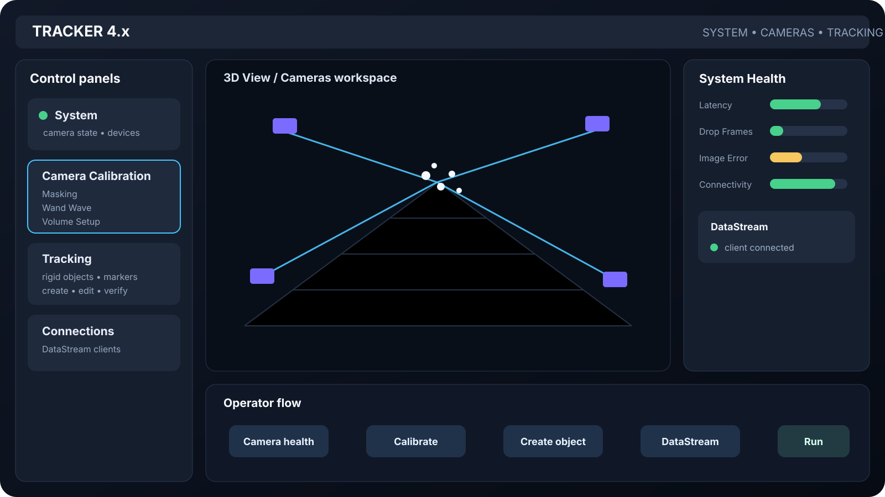
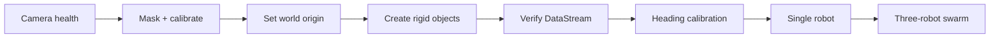

# Sphero + Vicon Swarm Control

  <h1>Sphero + Vicon Swarm Control</h1>
  
A reproducible toolkit for Vicon-referenced control of Sphero BOLT/BOLT+ chariots, from camera calibration and DataStream verification through per-robot heading calibration and multi-robot control.

  

    Vicon-referenced
    Python 3.11+
    Hardware + simulation
    Public reproducible workflow
  

  
<h3><a href="vicon-setup.md">Reproduce the lab</a></h3>
Camera health, masking, wand wave, origin, rigid objects and staged validation.

  
<h3><a href="vicon-tracker-ui-guide.md">Tracker visual guide</a></h3>
Version-aware visual references plus crisp, scalable interface maps.

  
<h3><a href="vicon-datastream.md">DataStream SDK</a></h3>
Connect Tracker to Python and verify subject/segment identity before motion.

  
<h3><a href="vicon-operator-checklist.md">Operator checklist</a></h3>
Bench-side runbook with no blurry screenshots or fragile external image dependencies.

<figure class="sv-figure sv-figure--wide">
  
  <figcaption>Tracker 4.x system map. This vector illustration is deliberately local and resolution-independent; the visual guide also links to real Tracker screenshots for appearance/version comparison.</figcaption>
</figure>

## Reproduction path

  
<h4>1. Software first</h4>
Install, run diagnostics and validate the simulator without physical hardware.

  
<h4>2. Tracking before motion</h4>
Verify camera health, rigid-object identity, world axes and DataStream output.

  
<h4>3. Calibrate every robot</h4>
Measure Sphero command heading against observed Vicon displacement.

  
<h4>4. Scale deliberately</h4>
Single chariot → dry-run swarm → conservative physical multi-robot run.

## Key design choice

The repository uses the **Vicon DataStream SDK** as the live pose interface. Tracker's UDP Object Stream is not required.

This keeps the lab procedure aligned with `src/sphero_vicon_swarm/tracking/vicon.py`, while configuration keeps site-specific addresses, device names and object identifiers outside source control.

## Documentation map

1. [Getting started](getting-started.md)
2. [Vicon setup and reproduction workflow](vicon-setup.md)
3. [Vicon Tracker visual guide](vicon-tracker-ui-guide.md)
4. [Vicon DataStream SDK setup](vicon-datastream.md)
5. [Vicon operator quick checklist](vicon-operator-checklist.md)
6. [Vicon procedure sources and version provenance](vicon-procedure-sources.md)
7. [Configuration](configuration.md)
8. [Hardware setup](hardware-setup.md)
9. [Control design](control-design.md)
10. [Validation](validation.md)
