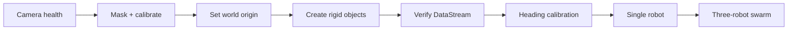

# Sphero + Vicon Swarm Control { .sv-page-title-hidden }

  
Sphero + Vicon Swarm Control

  
A reproducible toolkit for Vicon-referenced control of Sphero BOLT/BOLT+ chariots, from camera calibration and DataStream verification through per-robot heading calibration and multi-robot control.

  

    Vicon-referenced
    Python 3.11+
    Hardware + simulation
    Public reproducible workflow
  

  

<a href="end-to-end-tutorial/">End-to-end first run</a>

Clean PC to first safe multi-robot run, with exact pass/fail gates and real Tracker screenshots.

  

<a href="vicon-setup/">Vicon procedure</a>

Deep camera health, masking, calibration, origin, rigid-object and DataStream guidance.

  

<a href="vicon-tracker-ui-guide/">Tracker screenshot atlas</a>

Real Tracker 4.1 UI states mapped precisely to current Tracker 4.4 procedure wording.

  

<a href="vicon-datastream/">DataStream SDK</a>

Connect Tracker to Python and verify subject/segment identity before motion.

  

<a href="vicon-operator-checklist/">Operator checklist</a>

A concise bench-side runbook for calibration, object creation, DataStream verification and staged motion.

  

<a href="command-reference/">Command reference</a>

Know which commands are read-only, zero-speed, short-motion or closed-loop before you run them.

## Real Tracker interface

*Real Tracker 4.1 Wand Wave in progress: wand traces, per-camera counts and the Camera Calibration panel are all visible. The screenshot atlas explains every image state precisely.*

## Reproduction path

  

1. Software first

Install, run diagnostics and validate the simulator without physical hardware.

  

2. Tracking before motion

Verify camera health, rigid-object identity, world axes and DataStream output.

  

3. Calibrate every robot

Measure Sphero command heading against observed Vicon displacement.

  

4. Scale deliberately

Single chariot → dry-run swarm → conservative physical multi-robot run.

## Key design choice

The repository uses the **Vicon DataStream SDK** as the live pose interface. Tracker's UDP Object Stream is not required.

This keeps the lab procedure aligned with `src/sphero_vicon_swarm/tracking/vicon.py`, while configuration keeps site-specific addresses, device names and object identifiers outside source control.

## Documentation map

1. **[End-to-end first-run tutorial](end-to-end-tutorial.md)** — primary new-user path.
2. [Getting started](getting-started.md)
3. [Vicon setup and reproduction workflow](vicon-setup.md)
4. [Vicon Tracker visual guide](vicon-tracker-ui-guide.md)
5. [Vicon DataStream SDK setup](vicon-datastream.md)
6. [Vicon operator quick checklist](vicon-operator-checklist.md)
7. [Vicon procedure sources and version provenance](vicon-procedure-sources.md)
8. [Configuration](configuration.md)
9. [Hardware setup](hardware-setup.md)
10. [Control design](control-design.md)
11. [Validation](validation.md)
12. [Command reference](command-reference.md)
13. [Glossary](glossary.md)
