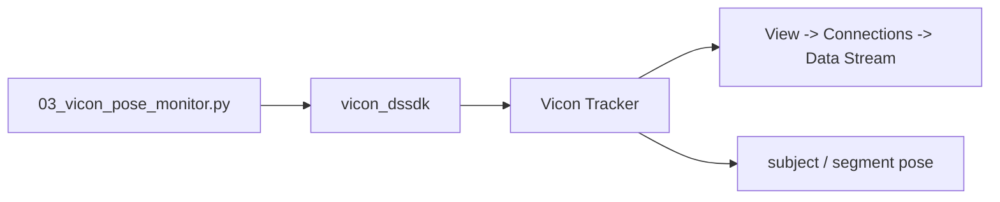

# Vicon DataStream SDK setup

The swarm reads live Vicon poses through the **Vicon DataStream SDK** using the Python module `vicon_dssdk`.

This page separates:

- **Vicon manufacturer information** — SDK version, installation guidance and connection example; from
- **project behaviour** — what this repository's adapter actually calls.

## 1. Current Vicon SDK

Vicon's current DataStream download page lists **DataStream SDK 1.13.0** as the latest point release and states that it supports Tracker 4.x.

Download it from Vicon:

https://www.vicon.com/software/datastream-sdk/

Do not commit the vendor installer into this repository.

## 2. Python installation

Vicon's Windows Python quick-start documentation installs the package from the DataStream SDK Python directory using pip. A typical 64-bit path is:

```text
C:\Program Files\Vicon\DataStream SDK\Win64\Python\vicon_dssdk
```

Install into the exact interpreter/environment used for this project:

```powershell
python -m pip install "C:\Program Files\Vicon\DataStream SDK\Win64\Python\vicon_dssdk"
```

### SDK 1.13 note for recent Python 3

Vicon's **DataStream SDK 1.13** release notes document a known issue: on some recent Python 3 installations (their example is Python 3.11.x), the supplied install batch file may fail when run from `Program Files`.

Vicon's documented workarounds are:

- run the batch file as administrator; or
- copy the package to a user-writable folder before running the install script.

Manufacturer reference:  
https://help.vicon.com/space/DSSDK113/726007829

## 3. Verify the import

```bash
python -c "import vicon_dssdk; print('vicon_dssdk import: OK')"
```

If this fails, fix the SDK/Python installation before debugging the swarm controller.

You can also run:

```bash
python -m sphero_vicon_swarm doctor
```

## 4. Configure the Tracker host

The local TOML expects a host and port:

```toml
[vicon]
server = "TRACKER_HOST:801"
```

Vicon's Python DataStream quick-start example connects to:

```python
client.Connect("localhost:801")
```

so this repository follows the same `HOST:PORT` convention.

Use the actual approved local hostname/address; do not copy an address from an old screenshot.

## 5. Verify the DataStream connection in Tracker



The [Tracker visual guide](vicon-tracker-ui-guide.md) contains real Tracker screenshots for calibration/object workflows. It deliberately does **not** fabricate a Connections screenshot.

For the **Connections** panel specifically, Vicon's current **Tracker ROS 2 Quick Start Guide (2026)** shows `View → Connections` and the live DataStream client workflow:
https://help.vicon.com/download/attachments/376309877/Vicon%20Tracker%20ROS%202%20Quick%20Start%20Guide.pdf

1. In Tracker, open **View → Connections**.
2. Leave the panel visible.
3. Run:

```bash
python examples/03_vicon_pose_monitor.py --config config/robot_setup.toml --seconds 20
```

4. Confirm a client appears in the **Data Stream** area.
5. In the terminal, confirm live coordinates/yaw are updating.
6. Move each physical chariot by hand and verify the intended software label changes.
7. Briefly occlude one rigid body and confirm the printed `occ` state changes.

## 6. What this repository actually calls

The project adapter is:

```text
src/sphero_vicon_swarm/tracking/vicon.py
```

It:

1. imports `ViconDataStream` from `vicon_dssdk`;
2. creates `ViconDataStream.Client()`;
3. calls `Connect(config.server)`;
4. requests `EServerPush` when supported;
5. attempts `SetBufferSize(1)`;
6. enables segment data;
7. requests frames;
8. reads global segment translation;
9. reads global Euler rotation.

Those statements are derived directly from the repository source, not inferred from Tracker UI.

### Why ServerPush appears in the code

Vicon's DataStream Developer's Guide describes **ServerPush** as the improved-performance stream mode compared with default ClientPull. This repository requests it when available.

### Why the buffer is set to one

That is a **project design choice**, not a Vicon manufacturer requirement. The controller prioritizes recent pose data over a backlog of older frames.

## 7. UDP Object Stream is a separate interface

The Tracker Connections UI can also expose UDP output settings.

This repository does not use them.

Enabling UDP does not change the project's adapter: the Python source still creates a DataStream client through `vicon_dssdk`.

So, for this repository, do not add UDP configuration as a required setup step.

## 8. Verify the returned data

Expected pose-monitor fields include:

- planar X coordinate in millimetres;
- planar Y coordinate in millimetres;
- yaw;
- occlusion state.

With the monitor running and **no robot commands active**:

1. move robot 1 only;
2. confirm only `robot-1` changes;
3. repeat for all robots;
4. check known axis directions;
5. rotate the rigid body;
6. briefly occlude it and inspect the occlusion flag.

## 9. Subject and segment names must match Tracker

The adapter calls:

```python
client.GetSegmentGlobalTranslation(vicon_subject, vicon_segment)
client.GetSegmentGlobalRotationEulerXYZ(vicon_subject, vicon_segment)
```

Therefore the TOML names must match the tracked object/segment names exactly.

Do not assume subject and segment names are identical if the local Tracker setup says otherwise.

## Troubleshooting

### Import fails

Fix `vicon_dssdk` installation first.

### Import works but Connect fails

Check:

- Tracker is running;
- the configured host is correct;
- client and Tracker host can communicate;
- the intended port is reachable;
- local firewall/network policy.

### Connect works but no useful pose appears

Check:

- the Tracker object is actually tracking;
- subject/segment names;
- live frames;
- occlusion;
- System Health.

### Pose looks correct but robot steering is wrong

That is not automatically a DataStream problem.

Run:

```bash
python examples/04_heading_calibration.py --config config/robot_setup.toml
```

The project intentionally measures Sphero-command to Vicon-world displacement rather than assuming those frames align.

## Manufacturer references

- DataStream SDK downloads/current version: https://www.vicon.com/software/datastream-sdk/
- DataStream SDK 1.13 release information: https://help.vicon.com/space/DSSDK113/726007829
- Vicon Python DataStream Quick Start: https://help.vicon.com/space/DSSDK110/9240617
- DataStream Developer's Guide: https://help.vicon.com/download/attachments/10027198/Vicon%20DataStream%20SDK%201.12%20Developers%20Guide.pdf

For source provenance, see [Vicon procedure sources](vicon-procedure-sources.md).
