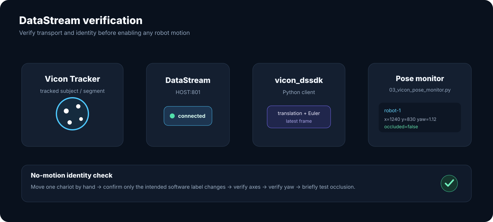

# Vicon operator quick checklist

<div class="sv-callout">
<strong>Bench-side use:</strong> use this page after reading the full <a href="vicon-setup.md">Vicon setup workflow</a>. UI screenshots below are real Vicon Tracker 4.1 captures; the written steps use current Tracker 4.4 terminology.
</div>

[](https://dasc-lab.github.io/robot-framework/flylab/calibration.html)

*Real Tracker 4.1 Camera Calibration workspace. Source: DASC Lab public Vicon setup documentation.*

## A. Start and verify Tracker

- [ ] Start the local Vicon workstation/camera network using the lab SOP.
- [ ] Open **Vicon Tracker**.
- [ ] Confirm the expected cameras are present in **System**.
- [ ] Move a reflective marker and confirm plausible reconstruction in **3D View**.
- [ ] Inspect **System Health Report** for obvious problems.

## B. If calibration is required

### Remove/mask reflections

[](https://dasc-lab.github.io/robot-framework/flylab/calibration.html)

*Real Tracker 4.1 masking workspace: Camera Calibration controls on the left and the multi-camera workspace on the right.*

- [ ] Remove or cover reflective sources where practical.
- [ ] Workspace → **Cameras**.
- [ ] Select the cameras in **System**.
- [ ] **Camera Calibration → Masking → Mask All**.
- [ ] Wait for unwanted light pixels to become masked/blue.
- [ ] Click **Stop**.
- [ ] Inspect every camera view.

### Wand wave

[](https://dasc-lab.github.io/robot-framework/flylab/calibration.html)

*Real Tracker 4.1 Wand Wave controls.*

[](https://dasc-lab.github.io/robot-framework/flylab/calibration.html)

*Real Tracker 4.1 calibration in progress, with Wand Count and Image Error visible.*

- [ ] **Camera Calibration → Wand Wave**.
- [ ] Select the correct physical calibration object.
- [ ] Click **Wave All**.
- [ ] Cover depth and height across the actual robot volume.
- [ ] Watch **Wand Count** and concentrate on low-count cameras.
- [ ] Let **Auto Stop** finish, or stop only after sufficient coverage.
- [ ] Review **Image Error** status.

### Origin

[](https://dasc-lab.github.io/robot-framework/flylab/calibration.html)

*Real Tracker 4.1 Volume Setup view.*

- [ ] Workspace → **3D View**.
- [ ] Place/orient the calibration device at the intended origin.
- [ ] **Camera Calibration → Volume Setup**.
- [ ] Under **Set Volume Origin**, select the correct device.
- [ ] Click **Start Set Origin**.
- [ ] When enabled, click **Set Origin**.
- [ ] Verify **X red / Y green / Z blue** physically.
- [ ] If required, use the separate **Set Floor Plane** workflow.

## C. Create each rigid object

[](https://dasc-lab.github.io/robot-framework/flylab/object.html)

*Real Tracker 4.1 3D View with an asymmetric marker cluster selected.*

[](https://dasc-lab.github.io/robot-framework/flylab/object.html)

*Real Tracker 4.1 Tracking panel showing the object-name field and **Create** control.*

- [ ] **View → Tracking**.
- [ ] Place the chariot in the calibrated volume.
- [ ] If required, enable **Unlabeled Markers** and **Unlabeled Reconstructions**.
- [ ] Select markers with **Ctrl + click** or **Alt + drag**.
- [ ] Select at least **4**; Vicon recommends **5+**.
- [ ] Enter a unique name in the **Object** field.
- [ ] Click **Create**.
- [ ] Move the chariot by hand and confirm only that object follows it.
- [ ] Use **Add Marker** / **Remove Marker** only if needed.
- [ ] Save the local Tracker object/setup.

## D. Record the mapping

| Physical chariot | Sphero/BLE name | Vicon object/subject | Vicon segment |
|---|---|---|---|
| Robot 1 | local value | local value | local value |
| Robot 2 | local value | local value | local value |
| Robot 3 | local value | local value | local value |

Never infer this from discovery order.

## E. Configure the repository

```powershell
Copy-Item config/robot_setup.example.toml config/robot_setup.toml
```

Enter:

- Tracker host/port;
- floor plane;
- each Sphero name;
- each Vicon object/subject;
- each segment;
- conservative measured workspace limits.

## F. Verify DataStream — no robot motion



*Architecture diagram, not a Tracker UI screenshot: Tracker → DataStream → `vicon_dssdk` → pose monitor.*

- [ ] Install/import `vicon_dssdk`.
- [ ] Tracker → **View → Connections**.
- [ ] Run:

```bash
python examples/03_vicon_pose_monitor.py --config config/robot_setup.toml --seconds 20
```

- [ ] Confirm a DataStream client appears.
- [ ] Move one chariot at a time and verify software identity.
- [ ] Check axis direction.
- [ ] Check yaw.
- [ ] Briefly test occlusion.

## G. Verify the Spheros

```bash
python examples/01_single_sphero_smoke_test.py --config config/robot_setup.toml
python examples/02_multi_sphero_smoke_test.py --config config/robot_setup.toml
```

## H. Calibrate command heading vs Vicon displacement

```bash
python examples/04_heading_calibration.py --config config/robot_setup.toml
```

- [ ] clear space;
- [ ] verify the correct rigid object;
- [ ] verify both calibration displacements are sensible.

## I. One robot before three

```bash
python reference_controllers/single_chariot_vicon_circle.py
```

## J. Dry-run, then physical swarm

```bash
python reference_controllers/three_chariot_square_swarm.py --dry-run --timeout 8 --no-digital-twin
python reference_controllers/three_chariot_square_swarm.py --laps 1 --max-speed 160
```

Before live motion:

- [ ] all three objects are visible;
- [ ] mappings are confirmed;
- [ ] workspace is clear;
- [ ] boundaries are conservative;
- [ ] an operator can stop the run immediately.

## Debug in this order

<div class="sv-codeflow">
<strong>camera health → calibration → rigid-object identity → DataStream → Sphero identity → heading calibration → single robot → swarm</strong>
</div>

For exact version notes and source provenance, see the [Tracker UI guide](vicon-tracker-ui-guide.md) and [Vicon procedure sources](vicon-procedure-sources.md).
