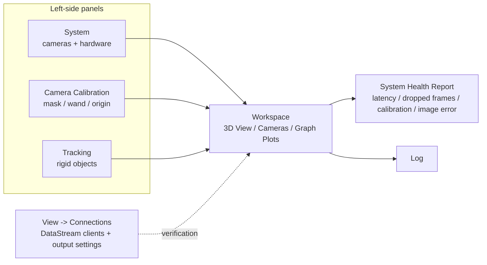
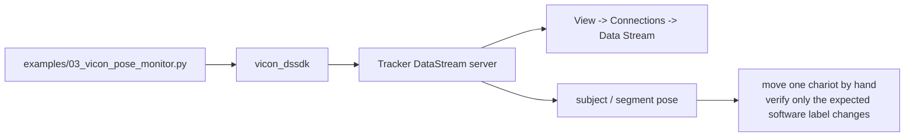

# Vicon Tracker visual guide — real UI + verified procedures

This page is the visual companion to the [full Vicon setup workflow](vicon-setup.md). Real application screenshots are used for UI recognition; diagrams are explicitly labelled and used only to explain navigation or data flow.

The primary guide uses **real Tracker 4.1 UI screenshots** for visual recognition and current Vicon Tracker 4.4 documentation for procedure wording. The old supplied low-resolution screenshots were removed from the public tree because several were malformed or too compressed to be useful.

## Read the version labels first

| Evidence | Version | How it is used |
|---|---:|---|
| Current procedure text | Tracker 4.4 | Primary authority for control names and workflow |
| Official Vicon online documentation | Tracker 4.4 / Tracker 4.x | High-resolution current visual reference |
| DASC Lab public UI captures | Tracker 4.1 | Real interface screenshots for visual recognition |

!!! warning "Use the installed Tracker version as the final UI authority"
    Tracker 4.x keeps the same core panel model, but controls and layout can move between point releases. Follow the current Vicon help for the version installed on the workstation.

## Real Tracker 4.1 visual orientation

[](https://dasc-lab.github.io/robot-framework/flylab/calibration.html)

*Real Tracker 4.1 Camera Calibration workspace.*

[](https://dasc-lab.github.io/robot-framework/flylab/object.html)

*Real Tracker 4.1 Tracking panel and 3D View during object creation.*

These are real application screenshots, not reconstructed UI artwork. Tracker 4.4 can move individual controls between point releases, so use the written 4.4 procedure below for exact current terminology.

!!! note "Version relationship"
    These screenshots are Tracker **4.1**, so they use the same Tracker 4 panel-based UI generation as Tracker 4.4. Button placement can move between point releases; the written instructions on this page follow current Tracker 4.4 terminology.

## Tracker 4.x navigation map (diagram)



### Which panel do I need?

| Task | Open / inspect |
|---|---|
| Confirm cameras are present and contributing | **System** |
| Remove unwanted reflections | **Camera Calibration -> Masking** |
| Run dynamic calibration | **Camera Calibration -> Wand Wave** |
| Set world origin / floor | **Camera Calibration -> Volume Setup** |
| Create or edit rigid objects | **Tracking** |
| Verify what the cameras reconstruct | **Workspace -> 3D View / Cameras** |
| Check latency, dropped frames and tracking health | **System Health Report** |
| Confirm the Python client has connected | **View -> Connections -> Data Stream** |

## Official high-resolution visual references

Use these before relying on an old screenshot:

- **Tracker 4.4 - Get to know Tracker**  
  https://help.vicon.com/space/Tracker44/376307984
- **Tracker 4.4 - Camera calibration properties**  
  https://help.vicon.com/space/Tracker44/376308704
- **Tracker 4.4 User Guide, 17 September 2025, Revision 1**  
  https://help.vicon.com/download/attachments/376309877/Vicon%20Tracker%20User%20Guide.pdf
- **Tracker 4 migration guide** - useful for the Tracker 4 panel/layout change from Tracker 3  
  https://help.vicon.com/download/attachments/14189359/Vicon%20Tracker%204%20Migration%20Guide.pdf

These references are kept external so the public MIT repository does not redistribute vendor documentation artwork.

---

## 1. Start Tracker and orient yourself

Before commanding a robot:

1. Open **Vicon Tracker**.
2. In **System**, confirm the expected cameras are present.
3. In the Workspace, select **3D View** and confirm reconstructed markers/objects appear.
4. Open or inspect **System Health Report**.
5. If you will verify the Python connection, open **View -> Connections**.

A healthy first check is visual and physical: move one marked chariot by hand and confirm the expected rigid object follows it in Tracker.

### System Health — what matters for this project

Tracker 4.4 exposes these sections in System Health:

- **Performance** - latency and dropped frames;
- **Calibration Details** - calibration state and uncalibrated cameras;
- **Centroid Connectivity** - how consistently moving 2D centroids are associated with tracked-object markers;
- **Image Error** - the pixel difference between measured centroids and the re-projected reconstructed 3D points;
- camera temperature / accelerometer information;
- camera-pose recovery and bias-handling information where enabled.

Tracker reports cameras above a **1.0 pixel Image Error diagnostic threshold** in the System Health header. Treat that as a troubleshooting signal, not as a universal accuracy requirement for every experiment.

---

## 2. Camera calibration

### Mask unwanted reflections

[](https://dasc-lab.github.io/robot-framework/flylab/calibration.html)

*Real Tracker 4.1 masking / Cameras view.*

Use **Camera Calibration -> Masking**.

1. Physically remove or cover reflective clutter where practical.
2. Change the Workspace to a **Cameras** view.
3. In **System**, select the cameras to calibrate.
4. Click **Mask All**.
5. Watch the camera views while Tracker creates masks.
6. Masked pixels are shown in blue.
7. Stop the masking operation once unwanted reflections are covered.
8. Inspect every camera view before continuing.

For a residual reflection, Tracker 4.x also provides **Manual Mask Paint** in the advanced masking controls.

Manufacturer reference:  
https://help.vicon.com/space/Tracker40/14190245

### Perform the wand wave

#### Controls before starting

[](https://dasc-lab.github.io/robot-framework/flylab/calibration.html)

[](https://dasc-lab.github.io/robot-framework/flylab/calibration.html)

Use **Camera Calibration -> Wand Wave**.

1. Confirm masking is complete.
2. Select the calibration object that matches the physical wand.
3. Click **Wave All**.
4. Cover the full useful volume, including depth and height.
5. Keep the wand visible to as many cameras as practical.
6. Watch per-camera **Wand Count**.
7. With **Auto Stop** enabled, allow Tracker to finish when enough data has been collected.
8. Inspect the resulting **Image Error** status.

After this stage, cameras are calibrated relative to each other; the world origin still needs to be set.

### Set the volume origin

[](https://dasc-lab.github.io/robot-framework/flylab/calibration.html)

Use **Camera Calibration -> Volume Setup**.

1. Change the Workspace to **3D View**.
2. Place the origin device where the project world origin should be.
3. Orient it to the intended world axes.
4. Under **Set Volume Origin**, choose the correct calibration object.
5. Click **Start Set Origin**.
6. Once enough data is collected, click **Set Origin**.
7. Verify the displayed axes:
   - **X = red**
   - **Y = green**
   - **Z = blue**
8. Physically confirm the floor, origin and positive directions.

If required, use Vicon's separate **Set Floor Plane** workflow after the origin is established.

---

## 3. Create and verify rigid objects

[](https://dasc-lab.github.io/robot-framework/flylab/object.html)

[](https://dasc-lab.github.io/robot-framework/flylab/object.html)

Tracker 4.4 uses the **Tracking** panel.

For best results, a rigid object should use at least **four asymmetric markers**; Vicon recommends five or more where practical.

1. Place the marked chariot in the calibrated volume.
2. If required, enable **Unlabeled Markers** in View Filters and **Unlabeled Reconstructions** in Processing.
3. Select the marker trajectories with **Ctrl + click** or **Alt + drag**.
4. Select at least four trajectories.
5. In **Tracking**, enter a unique object name.
6. Click **Create**.
7. Move the physical chariot by hand.
8. Confirm that only the intended object follows it.

Do not infer software mappings from list order. Record the exact Tracker object name for each physical chariot.

---

## 4. Verify the DataStream connection

The repository uses the **Vicon DataStream SDK** through `vicon_dssdk`. Tracker's UDP Object Stream is not required.



Run:

```bash
python examples/03_vicon_pose_monitor.py --config config/robot_setup.toml --seconds 20
```

Then:

1. open **View -> Connections** in Tracker;
2. confirm a client appears in **Data Stream**;
3. move robot 1 by hand and confirm only `robot-1` changes;
4. repeat for the remaining robots;
5. verify known world-axis directions;
6. rotate each object;
7. briefly occlude a marker set and inspect the returned occlusion state.

Only after this passes should robot motion be enabled.

---

## 5. Calibrate Sphero command heading against Vicon displacement

Run:

```bash
python examples/04_heading_calibration.py --config config/robot_setup.toml
```

The project deliberately does **not** assume that Tracker yaw and the Sphero command heading are the same frame. It measures the Vicon displacement produced by approximately orthogonal Sphero commands and derives the heading mapping from those measured vectors.

---

## Visual provenance and limitations

The original low-resolution lab JPEGs were removed from the public tree because several were malformed or too compressed to be useful. The UI screenshots on this page are real Tracker 4.1 captures from the public DASC Lab documentation, while current procedure wording is verified against Vicon Tracker 4.4.

### Screenshot attribution

The Tracker 4.1 screenshots above come from the public **DASC Lab robot-framework** setup documentation and are referenced from the source repository at commit `c3241aa50284640d379de1acb5f87774c5d415a2`. They are used as visual references for the real Tracker 4 interface; current procedure authority remains Vicon Tracker 4.4 documentation.

Source documentation: https://github.com/dasc-lab/robot-framework/tree/c3241aa50284640d379de1acb5f87774c5d415a2/docs/flylab

## Manufacturer references used for this page

- **Vicon Tracker 4.4 User Guide**, 2025-09-17, Revision 1  
  https://help.vicon.com/download/attachments/376309877/Vicon%20Tracker%20User%20Guide.pdf
- **Tracker 4.4 - Get to know Tracker**  
  https://help.vicon.com/space/Tracker44/376307984
- **Tracker 4.4 - Camera calibration properties**  
  https://help.vicon.com/space/Tracker44/376308704
- **Tracker 4.0 - Mask cameras**  
  https://help.vicon.com/space/Tracker40/14190245
- **Vicon DataStream SDK documentation**  
  https://help.vicon.com/space/DSSDK113

See the [full Vicon reproduction workflow](vicon-setup.md) for the complete startup-to-swarm sequence and stop criteria.
