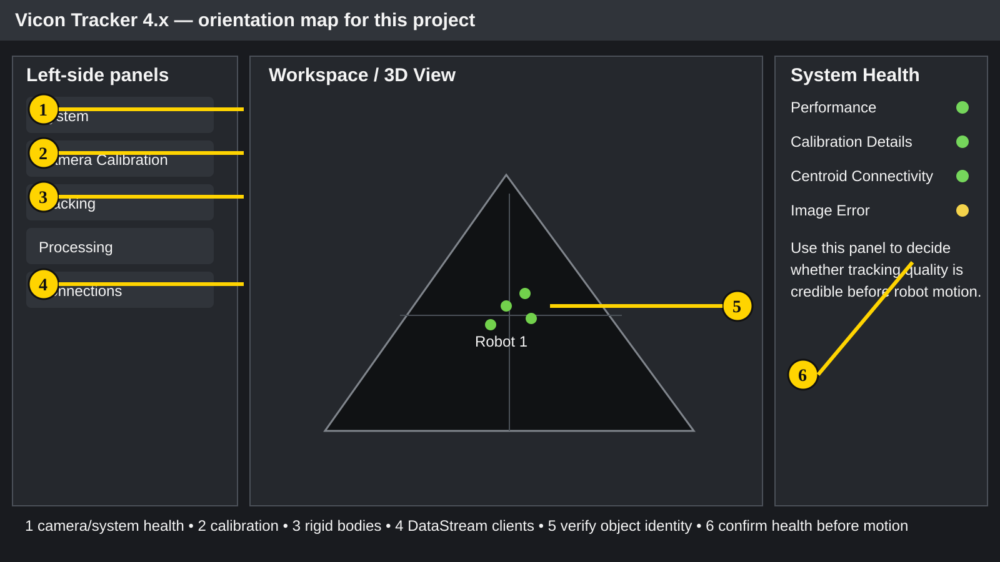
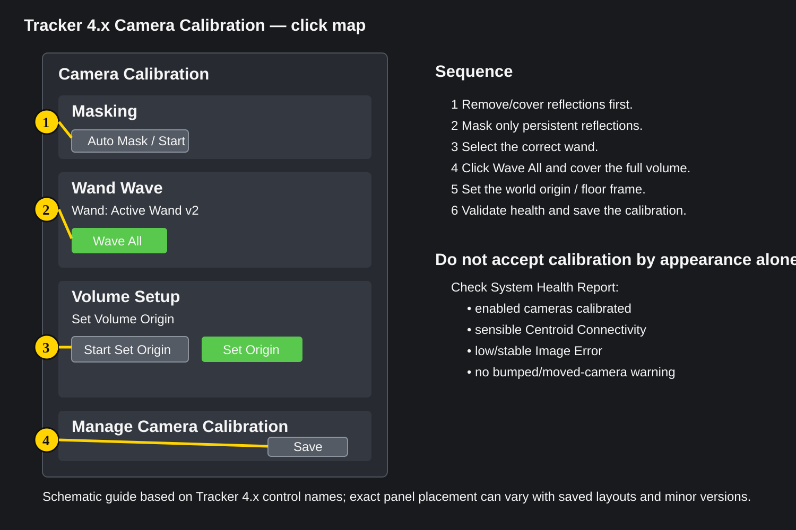
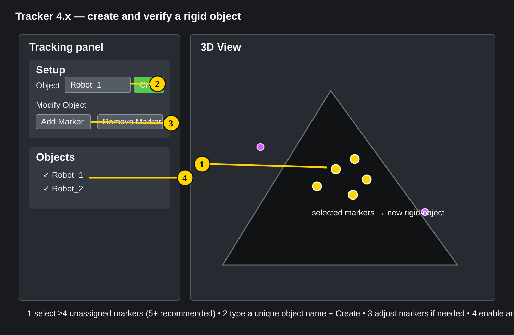
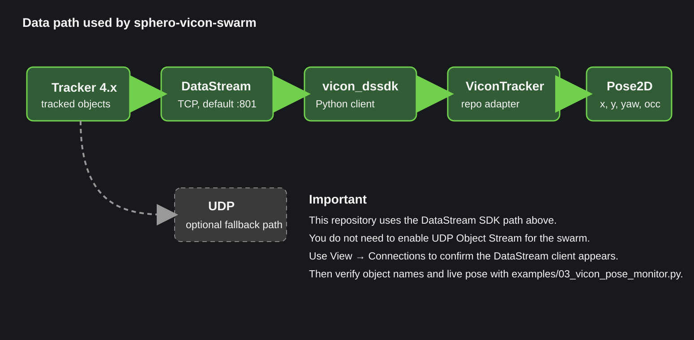

# Vicon Tracker visual guide

This page is a visual companion to the [step-by-step Vicon setup](vicon-setup.md).

The diagrams use **Tracker 4.x control names** and deliberately simplify the interface so the controls are easy to find. Saved layouts and minor Tracker versions can move panels around, so treat the diagrams as a click map rather than a pixel-perfect screenshot.

## 1. Know the four places you will use most



### What each numbered area is for

1. **System** — confirm cameras and connectivity hardware are present and healthy.
2. **Camera Calibration** — masking, wand wave, origin/floor-frame setup, and calibration management.
3. **Tracking** — create, modify, enable and inspect rigid objects.
4. **Connections** — see connected DataStream clients and optional OSC/UDP/VRPN outputs.
5. **3D View** — visually verify the marker constellation and which object is moving.
6. **System Health Report** — check performance, calibration state, centroid connectivity and image error before robot motion.

In Tracker 4.4, the **Connections** panel can be opened from **View → Connections**. It shows connected clients and settings for DataStream, OSC, UDP and VRPN.

## 2. Camera calibration click map



The current Tracker 4.4 workflow is:

1. remove or cover unwanted reflections where practical;
2. mask persistent reflections;
3. select the correct wand;
4. click **Wave All** and wave throughout the volume;
5. set the volume origin;
6. validate the result and save the calibration.

### Masking

Before calibration, inspect the camera views for bright/reflective points that are not part of the wand or intended markers.

Vicon recommends physically removing or covering unwanted reflections before masking because masking deliberately removes pixels from use.

If masking is required:

- open **Camera Calibration**;
- select the relevant camera(s);
- use the **Masking** section;
- start automatic masking, or use manual masking for residual reflections;
- confirm the camera views no longer contain unwanted reflection points.

### Wand wave

In **Camera Calibration → Wand Wave**:

1. select the correct calibration object, normally the wand configured for that system;
2. click **Wave All**;
3. move the wand through the actual area and height in which the robots will operate;
4. aim for useful coverage from as many cameras as possible;
5. allow Auto Stop to finish if it is enabled, or stop when the required coverage has been collected.

Tracker's current user guide describes **Wave All** as the normal way to start collecting wand-wave data for all cameras.

### Volume origin

After the camera calibration itself is complete, the cameras are calibrated relative to one another but the lab still needs a meaningful world coordinate frame.

In **Camera Calibration → Volume Setup → Set Volume Origin**:

1. select the appropriate origin/calibration device;
2. place it in the lab-approved location and orientation;
3. click **Start Set Origin**;
4. wait until Tracker has enough information;
5. click **Set Origin**;
6. verify the displayed red/green/blue axes agree with the intended floor and positive directions.

Do not compensate for a wrong world frame later by randomly swapping signs in the controller. Fix the Vicon frame first, then use the repository's explicit `floor_plane`, yaw sign/offset and heading calibration.

## 3. Creating a robot rigid body



Tracker 4.4 recommends a rigid object with **at least four asymmetric markers; five or more is recommended**.

For each chariot:

1. Attach a rigid, asymmetric marker pattern.
2. Make its geometry visibly different from every other robot.
3. Put the chariot in the capture volume.
4. In **View Filters**, ensure **Unlabeled Markers** is visible.
5. If necessary, in the **Processing** panel ensure unlabeled reconstructions are enabled.
6. Select at least four unassigned marker trajectories:
   - **Ctrl + click** to select individually; or
   - **Alt + drag** to box-select a group.
7. In the **Tracking** panel, enter a unique name in the **Object** field.
8. Click **Create**.
9. Move the robot by hand and confirm the created object follows only that physical robot.

### Fix a marker set

To add a marker:

- select the object;
- Ctrl-select the new marker;
- click **Add Marker**.

To remove a marker:

- select the marker;
- click **Remove Marker**.

Tracker prevents removal if the object would drop below four markers.

### Object naming convention

Use a simple stable convention such as:

```text
Robot_1
Robot_2
Robot_3
```

The exact names are site-local, but whatever you use in Tracker must match the `vicon_subject` / `vicon_segment` fields in the local TOML configuration.

## 4. Verify object identity before software control

This step prevents one of the most dangerous configuration mistakes: using robot A's Vicon pose to command robot B.

With all robot motion disabled:

1. Move physical robot 1 by hand.
2. Confirm only the intended Tracker object moves.
3. Repeat for robot 2 and robot 3.
4. Record the physical robot ↔ Sphero/BLE name ↔ Vicon object mapping.
5. Only then enter those values into `config/robot_setup.toml`.

Do not infer the mapping from list order.

## 5. DataStream vs UDP: use the correct path



This repository uses the **Vicon DataStream SDK over TCP/IP**.

That means you do **not** need to enable the UDP Object Stream to run this project.

Vicon's documentation describes the UDP stream as a smaller fallback interface for cases where the DataStream SDK cannot be used. The UDP stream contains only translation/rotation object data, whereas the DataStream SDK exposes a broader API.

For this repository:

- install `vicon_dssdk`;
- connect to the Tracker host on the DataStream port (normally `:801`);
- open **View → Connections** if you want to watch the client appear;
- use `examples/03_vicon_pose_monitor.py` to validate live data.

See [DataStream setup](vicon-datastream.md) for the exact software steps.

## 6. What to watch in System Health Report

Before live robot motion, open **System Health Report** and inspect at least:

### Performance

- latency;
- drop frames.

A controller can tolerate some latency, but unexpected jumps or dropped frames are a reason to stop and investigate.

### Calibration Details

Check that the enabled cameras expected to contribute are calibrated.

An old calibration is not automatically bad, but a moved/bumped camera, large temperature shift or worsening tracking quality can justify recalibration.

### Centroid Connectivity

This indicates how well moving 2D centroids are being associated with tracked object markers.

A low value can point to:

- reflections;
- occlusion;
- poor object geometry;
- camera calibration drift.

### Image Error

Tracker defines Image Error as the distance, in pixels, between observed 2D centroids and where the 3D points re-project into the camera image.

Rising or large image error can indicate degraded calibration or changed geometry.

Do not reduce the software workspace merely to hide a calibration issue. Fix the Vicon problem first; reduce the workspace only when coverage is genuinely weaker near the physical edges.

## 7. Fast validation sequence at the workstation

Once Tracker is healthy:

```text
Tracker objects visible
      ↓
python examples/03_vicon_pose_monitor.py
      ↓
move each robot by hand
      ↓
verify x/y direction + occlusion
      ↓
python examples/04_heading_calibration.py
      ↓
single robot closed-loop test
      ↓
three-robot dry run
      ↓
low-speed physical swarm
```

The companion [operator checklist](vicon-operator-checklist.md) condenses this into a bench-side list.

## Official references

These instructions were cross-checked against Vicon's current public documentation:

- [Vicon Tracker documentation](https://help.vicon.com/page/tracker-docs)
- [Tracker 4.4 User Guide](https://help.vicon.com/download/attachments/376309877/Vicon%20Tracker%20User%20Guide.pdf)
- [Vicon DataStream SDK downloads](https://www.vicon.com/software/datastream-sdk/?section=downloads)
- [DataStream SDK 1.13 documentation](https://help.vicon.com/space/DSSDK113)
